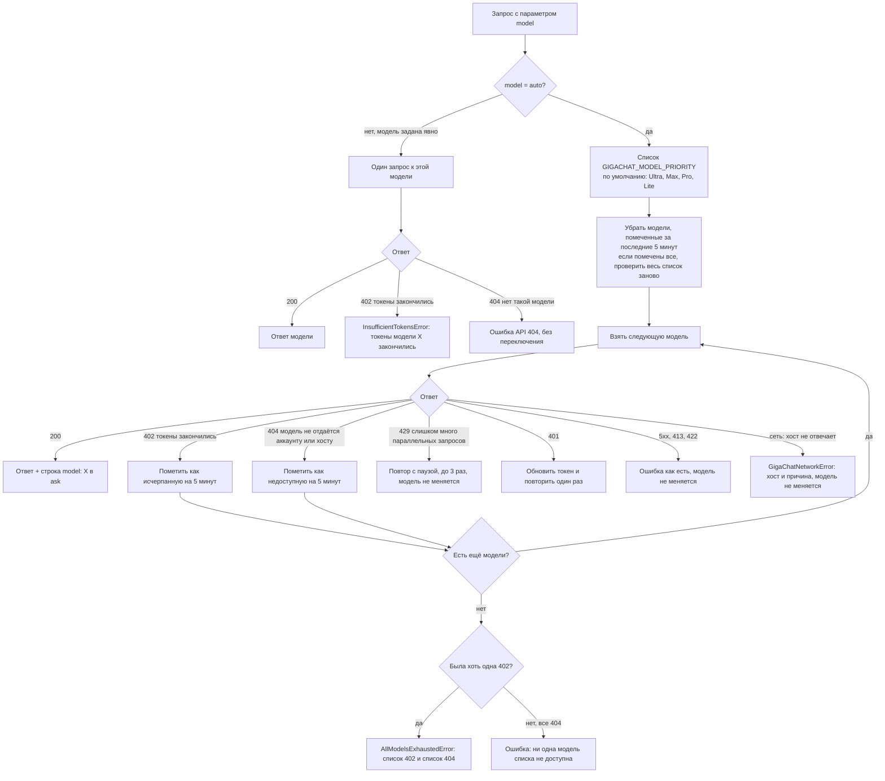

# Выбор модели и автовыбор

## Где и как задать модель

| Где | Как |
|---|---|
| Чат opencode | `/models` → `GigaChat (Sberbank)`, или `opencode run --model "GigaChat (Sberbank)/GigaChat-2-Max"`, или ключ `model` в `opencode.json` |
| Сабагент opencode | `"model": "GigaChat (Sberbank)/GigaChat-2-Pro"` в описании агента |
| MCP `ask` и `run_agent` | параметр `model`; по умолчанию `ask` берёт `GigaChat`, `run_agent` берёт `GIGACHAT_AGENT_MODEL` |
| Сабагент Claude Code | в его промпте: «всегда передавай `model: auto`» |

Доступные модели: `GigaChat`, `GigaChat-2`, `GigaChat-2-Pro`, `GigaChat-2-Max`, `GigaChat-Pro`, `GigaChat-Max` и виртуальная `auto`. Модели первого поколения (`GigaChat`, `-Pro`, `-Max`) перенаправляются на второе поколение.

## Автовыбор: `auto`

`auto` перебирает список **от лучшей модели к худшей** и использует первую рабочую. По умолчанию порядок по уровням тарифа, от сильного к слабому:

| Уровень | id модели |
|---|---|
| Ultra | `GigaChat-3-Ultra` |
| Max | `GigaChat-2-Max` |
| Pro | `GigaChat-2-Pro` |
| Lite | `GigaChat-2` |

Свой порядок задаётся в `~/.config/gigachat/.env`:

```
GIGACHAT_MODEL_PRIORITY=GigaChat-3-Ultra,GigaChat-2-Max,GigaChat-2-Pro,GigaChat-2
```

Как включить: `model: "auto"` в `ask` и `run_agent`, `GigaChat (Sberbank)/auto` в opencode, `GIGACHAT_AGENT_MODEL=GigaChat (Sberbank)/auto` для `run_agent` по умолчанию. `ask` с `auto` добавляет в конец ответа строку `[model: ...]` с реально отвечавшей моделью.

## Когда модель меняется, а когда нет

Переключение на следующую модель происходит только в двух случаях, чтобы причину нельзя было спутать с другой ошибкой:

- **HTTP 402**: по документации Сбера, «закончились токены модели, к которой выполняется запрос». Это однозначный сигнал.
- **HTTP 404 «No such model»**: модель не отдаётся этому аккаунту или хосту (например, Ultra на старом хосте). Её просто пропускают. Для явно заданной модели 404 остаётся обычной ошибкой.

Остальные ответы модель не меняют:

- 429 (слишком много параллельных запросов): повтор с паузой, до 3 раз;
- 401: обновление токена и один повтор;
- 413, 422 (слишком большой или неверный запрос), 5xx: ошибка как есть;
- сеть (хост не отвечает): `GigaChatNetworkError`, см. [VPN и новый хост](vpn-and-hosts.md).

## Схема

На GitHub схема рисуется автоматически. Во встроенном просмотре, который не поддерживает Mermaid, виден только её текст.



Пример: Ultra не отдаётся хосту (404), у Max токены закончились (402). `auto` пропустит Ultra, пометит Max исчерпанной и ответит Pro. Следующие 5 минут Ultra и Max не проверяются, запрос сразу идёт к Pro. Через 5 минут (или когда исчерпаны все) порядок проверяется заново с Ultra.

## Ошибки

- Токены кончились у **явно заданной** модели: `InsufficientTokensError`, текст «GigaChat tokens are exhausted for model "X" (HTTP 402 Payment Required)».
- Токены кончились у всех доступных моделей списка: `AllModelsExhaustedError` с двумя списками, «токены закончились (402)» и «недоступны (404)».
- Все модели списка недоступны (404): ошибка говорит именно об этом, а не о токенах.

Остаток токенов (`GET /balance`) для выбора не используется: у тарифа pay-as-you-go он отвечает 403, а надёжным сигналом остаётся ответ 402 на сам запрос.

## Что проверено

На аккаунте Freemium (Ultra, Max, Pro, Lite): по умолчанию отвечает Max после пропуска Ultra (404); без Max отвечает Pro; со списком из Ultra и Lite отвечает Lite; список из несуществующих моделей даёт понятную ошибку; работает через MCP в Claude Code и в opencode. Переход при настоящем 402 вживую не наблюдался (у всех моделей на аккаунте есть токены), он проверен тестами по поведению из документации.
